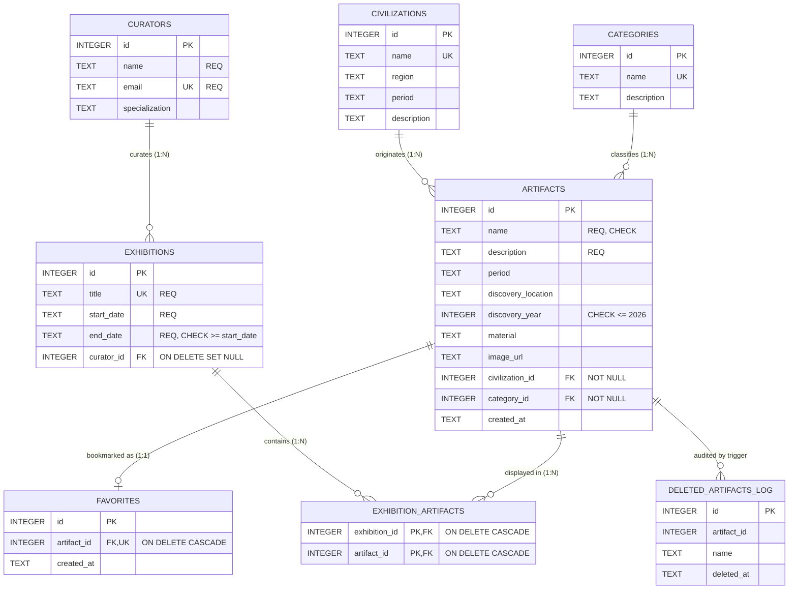

# Museum Artifact Explorer

An interactive, responsive full-stack web application designed for exploring historical museum artifacts across ancient civilizations, periods, and classifications. Built with **Python Flask**, **SQLite**, and modern **Vanilla HTML5/CSS3/JavaScript**.

---

## 1. Project Overview & Objectives

**Museum Artifact Explorer** is developed for a College Database Management System (DBMS) project. The project demonstrates:
- Relational database modeling with **SQLite**.
- Integrity constraints: Primary Keys, Foreign Keys, Unique constraints, Cascading Deletes (`ON DELETE CASCADE`), and check constraints.
- Foreign key enforcement with `PRAGMA foreign_keys = ON`.
- Parameterized SQL queries to prevent SQL injection vulnerabilities.
- Multi-table `JOIN` operations across artifacts, civilizations, categories, and favorites.
- Full CRUD functionality (Create, Read, Update, Delete) on artifacts.
- Live searching, multi-criteria filtering, and user favoriting.
- An aesthetically refined museum theme (warm beige, cream, dark brown, and muted gold palette).

---

## 2. Technologies Used

- **Backend**: Python 3, Flask
- **Database**: SQLite3 (via Python standard library `sqlite3`)
- **Templating**: Flask Jinja2
- **Frontend**: Semantic HTML5, Vanilla CSS3 (custom CSS design system with Google Fonts *Playfair Display* & *Inter*), Modern Vanilla JavaScript (ES6+)
- **Development Tooling**: Windows PowerShell / Modern Web Browser

---

## 3. Project Structure

```text
museum-artifact/
├── app.py                     # Flask application entry point and route handlers
├── database.py                # Database initialization, schema creation, triggers, and seeding
├── test_app.py                # Comprehensive automated test suite
├── queries.sql                # 14+ documented SQL queries (JOINs, Aggregates, M:N, Triggers)
├── generate_er.py             # Script generating docs/er_diagram.png via matplotlib
├── requirements.txt           # Python package dependencies
├── README.md                  # Comprehensive documentation and project guide
├── REPORT.md                  # Detailed project deliverables report
├── .gitignore                 # Files excluded from version control (includes museum.db)
├── docs/
│   └── er_diagram.png         # High-resolution Entity-Relationship diagram
├── templates/                 # Jinja2 HTML templates
│   ├── base.html              # Base layout with navbar, footer, flash alerts
│   ├── index.html             # Homepage: Hero, Artifact of Day, Highlights, Stats
│   ├── artifacts.html         # Artifact catalog with search, filter, and card grid
│   ├── artifact_detail.html   # Detailed artifact view with full provenance and actions
│   ├── add_artifact.html      # Create new artifact form with validation
│   ├── edit_artifact.html     # Edit artifact form with prefilled values
│   ├── civilizations.html     # List of civilizations with artifact counts
│   ├── categories.html        # List of categories with thematic icons & counts
│   ├── exhibitions.html       # Exhibitions list with dates, curators, and artifact counts
│   ├── exhibition_detail.html # Exhibition detail with curator and curated artifact cards
│   ├── favorites.html         # User favorites collection
│   └── 404.html               # Custom museum-themed 404/500 error page
└── static/
    ├── css/
    │   └── style.css          # Museum palette, typography, responsive grid
    ├── js/
    │   └── script.js          # Mobile navbar, auto-dismiss alerts, image fallbacks
    └── images/                # Local asset storage
```

---

## 4. Database Schema & Design

The relational database enforces data integrity through **7 core tables, 1 audit table, 1 view, 1 trigger, and 2 performance indexes**:

### Table 1: `civilizations`
| Column | Type | Constraints | Description |
|---|---|---|---|
| `id` | INTEGER | PRIMARY KEY AUTOINCREMENT | Unique civilization identifier |
| `name` | TEXT | NOT NULL, UNIQUE | Civilization name (e.g., Indus Valley, Egyptian) |
| `region` | TEXT | | Geographical origin region |
| `period` | TEXT | | Epoch or historical date span |
| `description` | TEXT | | Cultural and historical summary |

### Table 2: `categories`
| Column | Type | Constraints | Description |
|---|---|---|---|
| `id` | INTEGER | PRIMARY KEY AUTOINCREMENT | Unique category identifier |
| `name` | TEXT | NOT NULL, UNIQUE | Category title (e.g., Pottery, Sculpture, Coins) |
| `description` | TEXT | | Functional/material description |

### Table 3: `artifacts`
| Column | Type | Constraints | Description |
|---|---|---|---|
| `id` | INTEGER | PRIMARY KEY AUTOINCREMENT | Unique artifact identifier |
| `name` | TEXT | NOT NULL, CHECK(length(trim(name)) > 0) | Artifact title |
| `description` | TEXT | NOT NULL | Detailed background & provenance |
| `period` | TEXT | | Historical period or dynasty |
| `discovery_location`| TEXT | | Excavation / discovery site |
| `discovery_year` | INTEGER | CHECK(discovery_year IS NULL OR discovery_year <= 2026) | Excavation year (BCE supported via negative values) |
| `material` | TEXT | | Material composition (Bronze, Gold, etc.) |
| `image_url` | TEXT | | Public image link or local path |
| `civilization_id` | INTEGER | NOT NULL, FOREIGN KEY -> `civilizations(id)` | Associated civilization |
| `category_id` | INTEGER | NOT NULL, FOREIGN KEY -> `categories(id)` | Associated category |
| `created_at` | TEXT | DEFAULT `(datetime('now'))` | Timestamp of database addition |
| **Composite** | UNIQUE | `UNIQUE(name, civilization_id)` | Prevents duplicate artifact titles within a civilization |

### Table 4: `favorites`
| Column | Type | Constraints | Description |
|---|---|---|---|
| `id` | INTEGER | PRIMARY KEY AUTOINCREMENT | Unique favorite identifier |
| `artifact_id` | INTEGER | NOT NULL, UNIQUE, FOREIGN KEY -> `artifacts(id)` ON DELETE CASCADE | Reference to favorited artifact |
| `created_at` | TEXT | DEFAULT `(datetime('now'))` | Timestamp when added to favorites |

### Table 5: `curators`
| Column | Type | Constraints | Description |
|---|---|---|---|
| `id` | INTEGER | PRIMARY KEY AUTOINCREMENT | Unique curator identifier |
| `name` | TEXT | NOT NULL | Curator's full name |
| `email` | TEXT | NOT NULL, UNIQUE | Contact email address |
| `specialization` | TEXT | | Field of historical / archaeological expertise |

### Table 6: `exhibitions`
| Column | Type | Constraints | Description |
|---|---|---|---|
| `id` | INTEGER | PRIMARY KEY AUTOINCREMENT | Unique exhibition identifier |
| `title` | TEXT | NOT NULL, UNIQUE | Exhibition title |
| `start_date` | TEXT | NOT NULL | Opening date (YYYY-MM-DD) |
| `end_date` | TEXT | NOT NULL, CHECK(end_date >= start_date) | Concluding date (must be >= start date) |
| `curator_id` | INTEGER | FOREIGN KEY -> `curators(id)` ON DELETE SET NULL | Curator in charge of the exhibition |

### Table 7: `exhibition_artifacts` (Many-to-Many M:N Association)
| Column | Type | Constraints | Description |
|---|---|---|---|
| `exhibition_id` | INTEGER | NOT NULL, FOREIGN KEY -> `exhibitions(id)` ON DELETE CASCADE | Target exhibition |
| `artifact_id` | INTEGER | NOT NULL, FOREIGN KEY -> `artifacts(id)` ON DELETE CASCADE | Associated artifact |
| **Primary Key** | Composite | `PRIMARY KEY (exhibition_id, artifact_id)` | Unique exhibition-to-artifact mapping |

### Table 8: `deleted_artifacts_log` (Audit Trail)
| Column | Type | Constraints | Description |
|---|---|---|---|
| `id` | INTEGER | PRIMARY KEY AUTOINCREMENT | Unique audit log ID |
| `artifact_id` | INTEGER | NOT NULL | ID of deleted artifact |
| `name` | TEXT | NOT NULL | Title of deleted artifact |
| `deleted_at` | TEXT | DEFAULT `(datetime('now'))` | Deletion timestamp |

### View: `artifact_details`
Denormalized SQL View joining `artifacts`, `civilizations`, and `categories` to provide pre-joined metadata (`civilization`, `region`, `civ_period`, `category`) without redundant join syntax in queries.

### Trigger: `trg_artifact_deleted`
`AFTER DELETE` trigger on table `artifacts`. Automatically logs the deleted artifact's ID, title, and timestamp into `deleted_artifacts_log`.

### Indexes:
- `idx_artifacts_name`: Index on `artifacts(name)` for optimized search operations.
- `idx_artifacts_civ_cat`: Composite index on `artifacts(civilization_id, category_id)` for dual-filter queries.

---

## 5. Entity-Relationship (ER) Diagram



A standalone high-resolution diagram is available at [`docs/er_diagram.png`](file:///c:/Users/AIML%2027/OneDrive/文档/museum-artifact/docs/er_diagram.png).

---

## 6. Database Normalization (1NF / 2NF / 3NF)

The database schema is rigorously structured according to relational normalization principles:

1. **First Normal Form (1NF)**:
   - Every column contains atomic (indivisible) values.
   - Repeating groups and array lists within single fields (e.g., storing comma-separated artifact lists in exhibitions) are strictly prohibited.
   - Every table possesses an unambiguous Primary Key (`id` or composite `(exhibition_id, artifact_id)`).

2. **Second Normal Form (2NF)**:
   - The schema satisfies 1NF.
   - All non-key attributes are fully functionally dependent on the entire primary key.
   - In `exhibition_artifacts`, the junction table only stores the composite foreign keys `(exhibition_id, artifact_id)`. Specific exhibition metadata (e.g., dates) resides exclusively in `exhibitions`, eliminating partial key dependencies.

3. **Third Normal Form (3NF)**:
   - The schema satisfies 2NF.
   - Non-key attributes are non-transitively dependent on primary keys (no attribute depends on another non-key attribute).
   - Civilization regions and periods are stored in `civilizations`, not duplicated across each artifact record in `artifacts`.
   - Curator contact information and specializations are stored in `curators`, referenced by foreign key in `exhibitions`.

| Table | Normal Form | Key Design Rationale |
|---|---|---|
| `civilizations` | 3NF | Eliminates transitive dependencies between civilization name, region, and epoch. |
| `categories` | 3NF | Isolates artifact classification taxonomy from physical artifacts. |
| `artifacts` | 3NF | Core entity with atomic attributes; references civilizations and categories via non-null FKs. |
| `favorites` | 3NF | 1:1 user bookmark mapping with cascading deletion integrity. |
| `curators` | 3NF | Isolates staff profiles from exhibition dates and venues. |
| `exhibitions` | 3NF | Encapsulates temporal exhibition events; links to curator via foreign key. |
| `exhibition_artifacts` | 3NF | Pure junction entity modeling the M:N relationship between exhibitions and artifacts. |
| `deleted_artifacts_log` | 1NF/Audit | Append-only historical log populated by database trigger upon artifact deletion. |

---

## 6. Installation & Execution Guide (Windows)

### Step 1: Open Terminal in Project Directory
Navigate to the repository folder:
```powershell
cd museum-artifact
```

### Step 2: Create and Activate Virtual Environment
```powershell
python -m venv .venv
.\.venv\Scripts\Activate.ps1
```

> **Note on PowerShell Execution Policy**: If PowerShell blocks script execution with a permission error, either bypass it for the current terminal session:
> ```powershell
> Set-ExecutionPolicy -Scope Process -ExecutionPolicy Bypass
> .\.venv\Scripts\Activate.ps1
> ```
> Or invoke Python directly without activation:
> ```powershell
> .\.venv\Scripts\python.exe -m pip install -r requirements.txt
> .\.venv\Scripts\python.exe database.py
> .\.venv\Scripts\python.exe app.py
> ```

### Step 3: Install Required Dependencies
```powershell
python -m pip install -r requirements.txt
```

### Step 4: Initialize the Database
```powershell
python database.py
```
This automatically builds all four tables and idempotently inserts the 5 civilizations, 6 categories, and 12 sample artifacts without duplicate conflicts.

### Step 5: Start the Flask Application
```powershell
python app.py
```

### Step 6: Access the Application
Open any web browser and visit:
👉 **[http://127.0.0.1:5000](http://127.0.0.1:5000)**

---

## 7. Example SQL Queries (DBMS College Requirements)

Here are the primary SQL statements executed within the application:

### 1. Multi-Table JOIN with LEFT JOIN for Favorites
```sql
SELECT
    a.id, a.name, a.description, a.period, a.material, a.image_url,
    c.name AS civilization,
    c.region AS region,
    cat.name AS category,
    CASE WHEN f.id IS NOT NULL THEN 1 ELSE 0 END AS is_favorite
FROM artifacts a
JOIN civilizations c ON a.civilization_id = c.id
JOIN categories cat ON a.category_id = cat.id
LEFT JOIN favorites f ON f.artifact_id = a.id
ORDER BY a.name ASC;
```

### 2. Multi-Criteria Filtering with WHERE and Parameterized Search
```sql
SELECT a.*, c.name AS civilization, cat.name AS category
FROM artifacts a
JOIN civilizations c ON a.civilization_id = c.id
JOIN categories cat ON a.category_id = cat.id
WHERE (a.name LIKE ? OR a.description LIKE ? OR a.material LIKE ?)
  AND a.civilization_id = ?
  AND a.category_id = ?;
```

### 3. Aggregate COUNT with GROUP BY and LEFT JOIN
```sql
SELECT c.id, c.name, c.region, c.period,
       COUNT(a.id) AS artifact_count
FROM civilizations c
LEFT JOIN artifacts a ON a.civilization_id = c.id
GROUP BY c.id
ORDER BY c.name;
```

### 4. INSERT (Add New Artifact)
```sql
INSERT INTO artifacts (
    name, description, period, discovery_location,
    discovery_year, material, image_url, civilization_id, category_id
) VALUES (?, ?, ?, ?, ?, ?, ?, ?, ?);
```

### 5. UPDATE (Edit Existing Artifact)
```sql
UPDATE artifacts
SET name = ?, description = ?, period = ?, discovery_location = ?,
    discovery_year = ?, material = ?, image_url = ?,
    civilization_id = ?, category_id = ?
WHERE id = ?;
```

### 6. DELETE with Cascading Foreign Keys
```sql
DELETE FROM artifacts WHERE id = ?;
```

---

## 8. Application Features

1. **Homepage**:
   - Welcome banner with live database counts (Artifacts, Civilizations, Categories).
   - Dynamic *Artifact of the Day* randomly spotlighted.
   - Curated highlights carousel with civilization badges.
2. **Artifact Catalog (`/artifacts`)**:
   - Live search across artifact names, descriptions, materials, and locations.
   - Dual filtering by Civilization dropdown and Category dropdown.
   - Period-specific filtering.
3. **Artifact Details (`/artifact/<id>`)**:
   - High-resolution museum image with fallback to historical glyph icons if offline.
   - Comprehensive provenance metadata: civilization, region, material, discovery year, location.
   - Quick one-click favorite toggle button.
   - Direct edit and secure modal-confirmed delete triggers.
4. **CRUD Management**:
   - `/artifact/add`: Client and server-side validated input forms.
   - `/artifact/<id>/edit`: Safe pre-populated form with update notifications.
   - `/artifact/<id>/delete`: Protected `POST` handler with JavaScript confirmation modal.
5. **Favorites System (`/favorites`)**:
   - Dedicated collection page displaying saved artifacts.
   - Instant removal toggle and duplicate prevention using SQL UNIQUE constraints.
6. **Civilizations & Categories Explorers**:
   - Dedicated index pages calculating live artifact counts per culture and medium.
   - One-click filtering from any civilization or category card.

---

## 9. Known Limitations & Future Improvements

- **User Authentication**: Currently designed for educational DBMS demonstration where favorites are accessible globally. Future versions can add user login with session-specific favorites.
- **Image Uploads**: Artifacts currently accept web URLs. Future updates could implement local file upload handling using `werkzeug.utils.secure_filename`.
- **Advanced Pagination**: The catalog currently displays query results dynamically. Client-side or cursor-based pagination can be added as the collection grows beyond 1,000 items.
